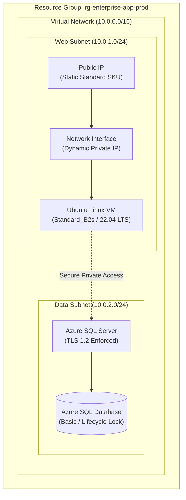

# Enterprise Azure Terraform Module Library

[](https://www.terraform.io/)
[](https://azure.microsoft.com/)
[](https://learn.microsoft.com/en-us/azure/cloud-adoption-framework/)
[](LICENSE)

A standardized, modular **Infrastructure as Code (IaC) library** for Microsoft Azure, aligned with the **Cloud Adoption Framework (CAF)**. This repository decouples Azure network, compute, and database resources into audited, reusable Terraform modules.

---

## 🏛️ Architecture Overview

The modules assemble into a secure multi-tier virtual network topology:



---

## 📦 Available Reusable Modules

| Module Directory | Managed Azure Resource | Key Capabilities |
| :--- | :--- | :--- |
| [`modules/azurerm_resource_group`](modules/azurerm_resource_group) | `azurerm_resource_group` | Standardized regional naming, resource tagging, and lifecycle hooks |
| [`modules/azurerm_virtual_network`](modules/azurerm_virtual_network) | `azurerm_virtual_network` | Software-defined virtual networks with custom CIDR address spaces |
| [`modules/azurerm_subnet`](modules/azurerm_subnet) | `azurerm_subnet` | Isolated subnets for Web, Application, and Data tiers |
| [`modules/azurerm_public_ip`](modules/azurerm_public_ip) | `azurerm_public_ip` | Static Standard SKU public IPs with DNS label support |
| [`modules/azurerm_network_interface`](modules/azurerm_network_interface) | `azurerm_network_interface` | Multi-IP configurations, public/private IP bindings, subnet associations |
| [`modules/azurerm_virtual_machine`](modules/azurerm_virtual_machine) | `azurerm_linux_virtual_machine` | Hardened Linux compute instances, OS disk caching, SSH injection |
| [`modules/azurerm_sql_server`](modules/azurerm_sql_server) | `azurerm_mssql_server` | Managed SQL Server with mandatory TLS 1.2 minimum version |
| [`modules/azurerm_sql_database`](modules/azurerm_sql_database) | `azurerm_mssql_database` | Managed relational database with `prevent_destroy` lifecycle safeguards |

---

## 🚀 Quickstart: Consuming the Modules

Reference the modules directly in your root Terraform configuration:

```hcl
# 1. Provision Resource Group
module "rg" {
  source   = "git::https://github.com/samarendra12/Samaridhi.git//modules/azurerm_resource_group?ref=v1.1.0"
  name     = "rg-production-eastus"
  location = "East US"
  tags     = { Environment = "Production", Owner = "PlatformOps" }
}

# 2. Provision Virtual Network
module "vnet" {
  source              = "git::https://github.com/samarendra12/Samaridhi.git//modules/azurerm_virtual_network?ref=v1.1.0"
  name                = "vnet-prod-eastus"
  location            = module.rg.location
  resource_group_name = module.rg.name
  address_space       = ["10.0.0.0/16"]
}

# 3. Provision Web Subnet
module "web_subnet" {
  source               = "git::https://github.com/samarendra12/Samaridhi.git//modules/azurerm_subnet?ref=v1.1.0"
  name                 = "snet-web"
  resource_group_name  = module.rg.name
  virtual_network_name = module.vnet.name
  address_prefixes     = ["10.0.1.0/24"]
}
```

A complete root implementation is available under [`examples/complete`](examples/complete).

---

## 🔒 Remote State Management & Locking

To ensure team concurrency and protect state integrity, always configure an Azure Storage Blob backend:

```hcl
terraform {
  backend "azurerm" {
    resource_group_name  = "rg-terraform-state-prod"
    storage_account_name = "samartfstateprod01"
    container_name       = "tfstate"
    key                  = "landing-zone.terraform.tfstate"
  }
}
```

* **Blob Lease Locking**: The AzureRM backend automatically acquires an exclusive lease on the blob during `terraform plan` and `terraform apply`, preventing simultaneous execution conflicts.
* **Encryption at Rest**: Azure Storage encrypts all state files using 256-bit AES encryption.

---

## 🛡️ Security Best Practices

1. **No Plaintext Passwords**: Database and VM passwords must be marked `sensitive = true` and injected via Azure Key Vault or CI/CD pipeline secrets.
2. **Data Loss Prevention**: Database modules enforce `prevent_destroy = true` in their lifecycle block to safeguard against accidental deletion during refactoring.
3. **Least Privilege & Private IP Routing**: Compute instances communicate with databases via internal subnet routing rather than public IP endpoints.

---

## 👨‍💻 Maintainer

**Samarendra Kumar**  
Senior Azure DevOps & Cloud Platform Engineer  
GitHub: [@samarendra12](https://github.com/samarendra12)
